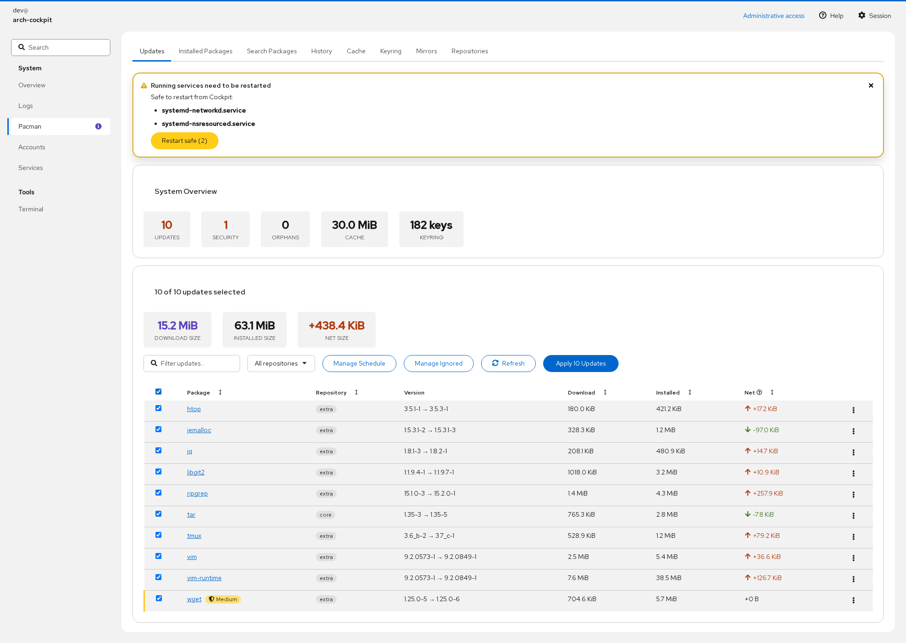
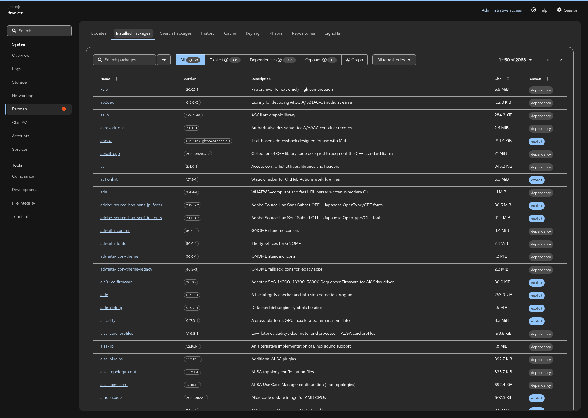
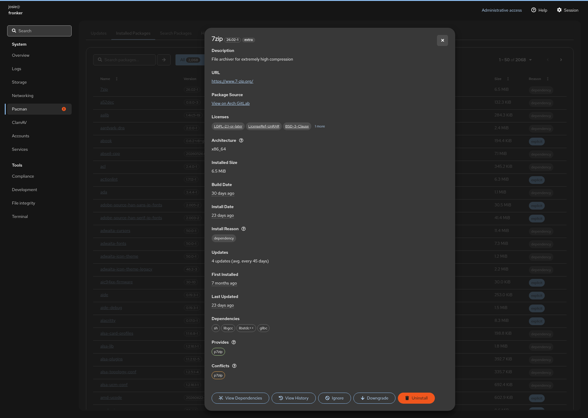
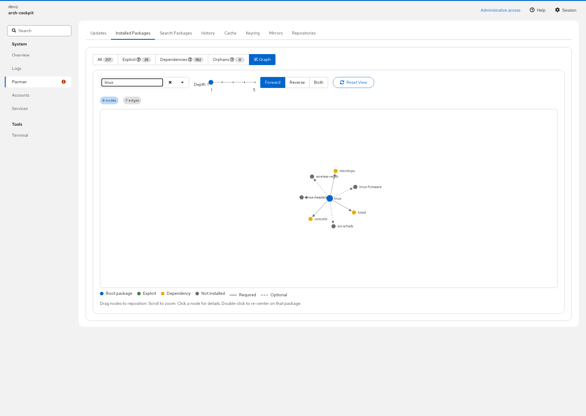
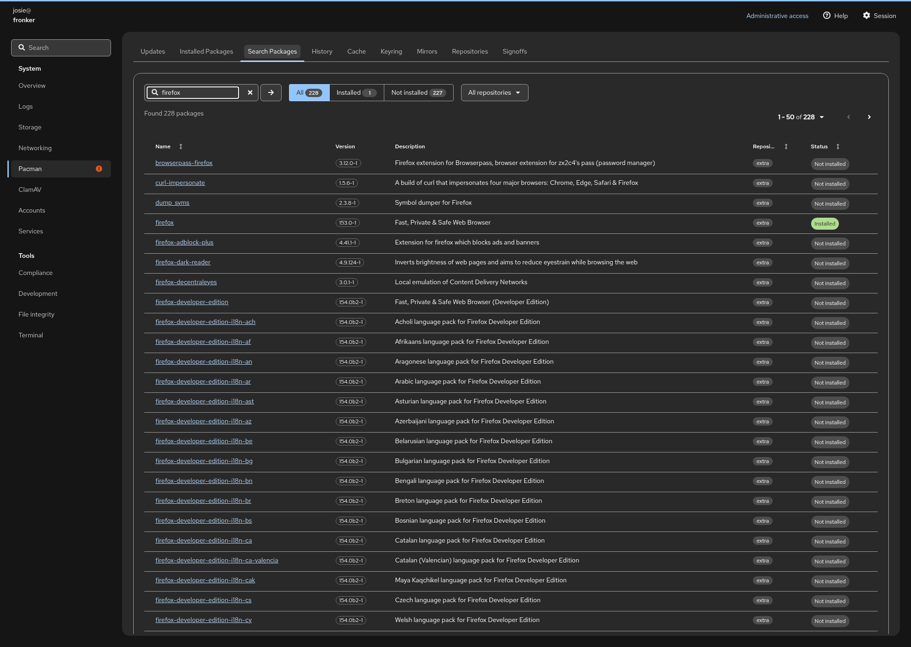
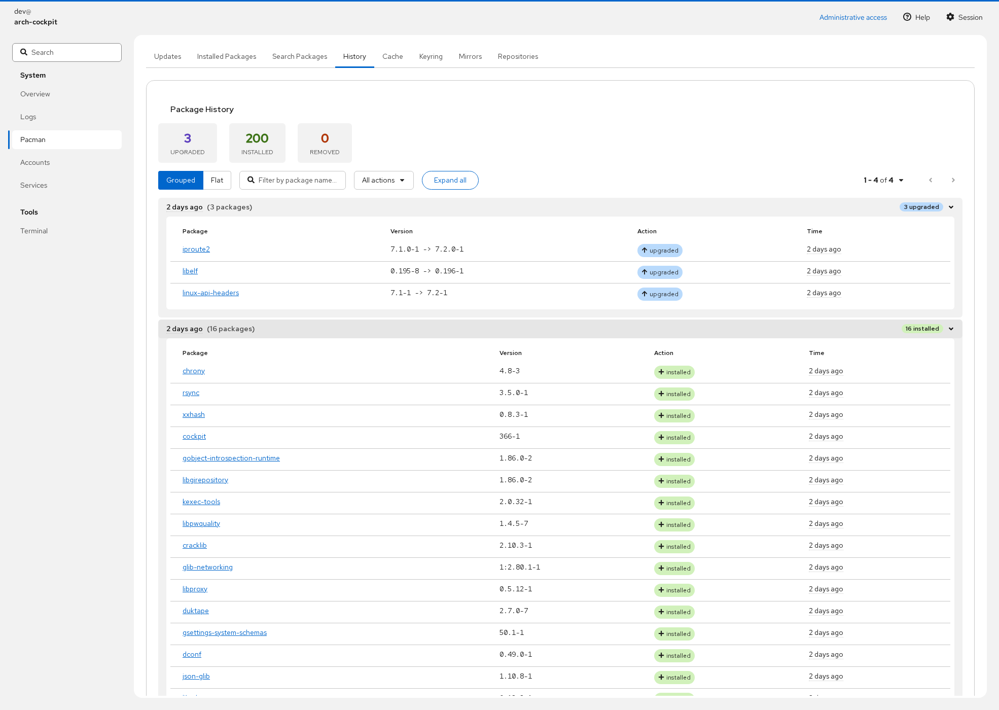
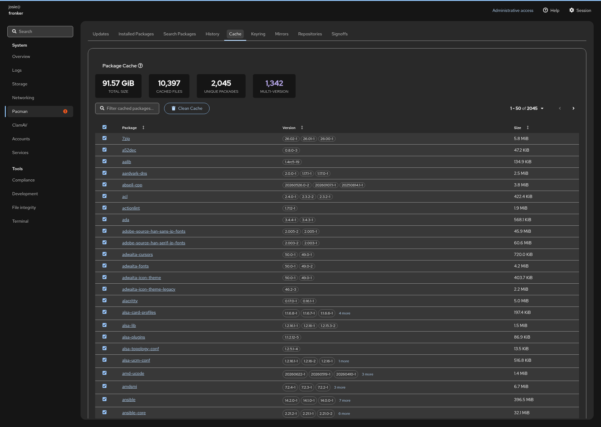
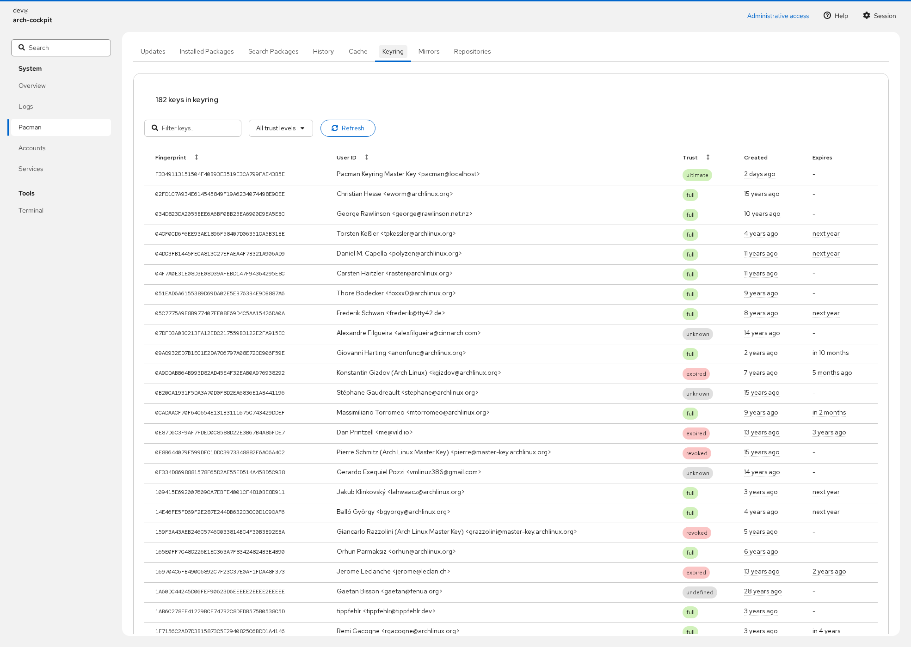
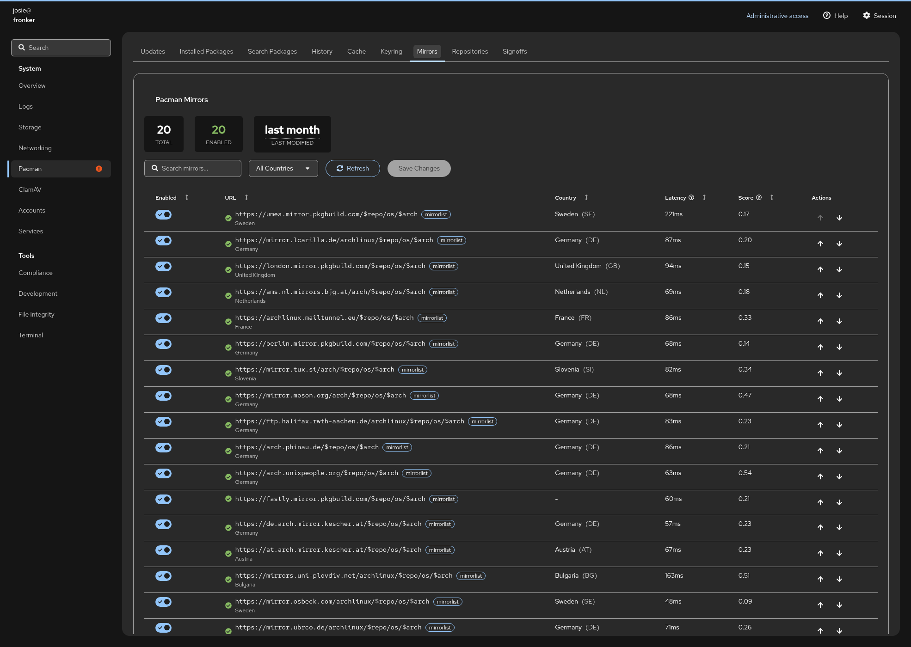
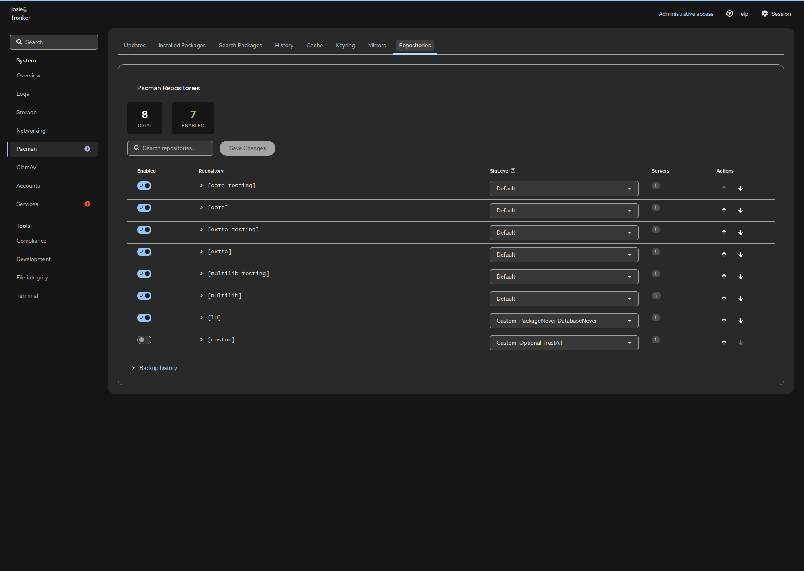

# cockpit-pacman

[](https://archlinux.org/packages/extra/x86_64/cockpit-pacman/)
[](https://aur.archlinux.org/packages/cockpit-pacman-git)

A Cockpit plugin for Arch Linux package management using direct alpm.rs integration.

Mirror: https://gitlab.archlinux.org/josie/cockpit-pacman

## Features


Check for updates with system overview, reboot notifications, and scheduled upgrades


Browse installed packages with filtering by install reason and repository

Press `/` to jump to a package or tab, and `?` for shortcuts. Tabs, filters
and open packages have bookmarkable URLs and support Back.

Manage third-party repositories and their signing keys in Repositories.
Arch packagers can configure [ArchWeb signoffs](docs/signoffs.md).

<details>
<summary>More screenshots</summary>


View package details beside the list, with reinstall and downgrade actions


Visualize package dependency relationships


Search available packages across repositories with install status


Browse package history grouped by upgrade runs


Manage package cache with configurable cleanup


View and manage pacman keyring


Test and configure pacman mirrors


Enable, disable, and reorder repositories with pacman.conf backup history

</details>

## Prerequisites

[Cockpit](https://cockpit-project.org/) must be installed and running:
```bash
sudo pacman -S cockpit
sudo systemctl enable --now cockpit.socket
```

## Installation

### From the official repositories (recommended)

```bash
sudo pacman -S cockpit-pacman
```

### Development builds from the AUR

`cockpit-pacman-git` builds the current main branch:

```bash
paru -S cockpit-pacman-git
```

### From source

Requires the Rust toolchain, npm, system libcurl, pkgconf, and a supported Node.js
version: 22.x from 22.22.2, 24.x from 24.15.0, or 26 and later. CI uses Node.js 24 LTS.

```bash
sudo pacman -S rust npm curl pkgconf
```

#### Build

```bash
make build
```

#### Install

```bash
# System-wide, when no cockpit-pacman package is installed
sudo make install

# Development (symlinks)
make devel-install
```

`make install` refuses to overwrite an installed `cockpit-pacman` or
`cockpit-pacman-git` package. Use the package manager to update that installation.
Package builds can stage files without modifying the running system:

```bash
make install DESTDIR="$pkgdir" PREFIX=/usr LIBEXECDIR=/usr/lib/cockpit-pacman
```

`LIBEXECDIR` selects the backend path in both the installed Cockpit manifest and
scheduled service. Its default is `/usr/libexec/cockpit-pacman`.
`make install-check` checks the live-install guard without writing files.

## Documentation

- [Troubleshooting](docs/troubleshooting.md): locked database, interrupted
  upgrade, a scheduled run with no record, where the config and backups live
- [Configuration](docs/configuration.md): settings and [proxies](docs/configuration.md#proxies)
- [Signoffs](docs/signoffs.md): ArchWeb credentials and the signoff view

## Development

```bash
make devel-install
npm run watch
```

The development install links frontend assets and the backend under
`~/.local`, and its manifest selects that backend. It does not install system
units; test scheduled work in the disposable VM. The user plugin takes
precedence over the packaged plugin for that account. Log out of Cockpit and
back in after installing it so the shell reads the new manifest.

## License

GPL-3.0
